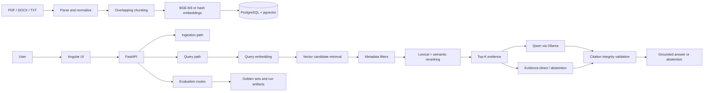
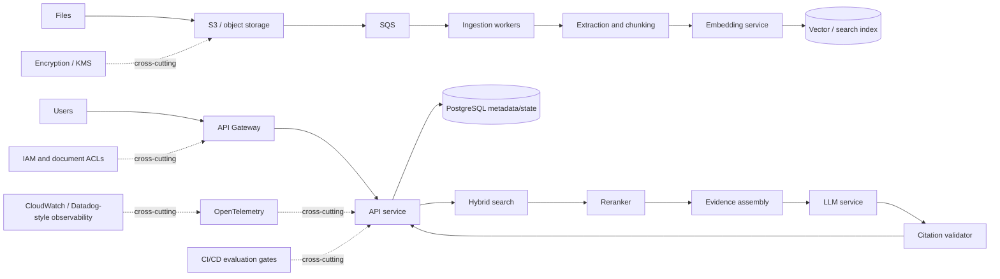

# Centralized Legal Corpus Q&A Service

Production-oriented legal RAG prototype demonstrating how a controlled legal
corpus can support grounded questions, traceable evidence, explicit abstention,
and regression-tested retrieval changes.

- FastAPI
- PostgreSQL + pgvector
- Legal-document ingestion
- BGE-M3 embeddings
- Semantic/vector retrieval
- Hybrid lexical + semantic reranking
- Grounded LLM responses
- Citation integrity
- Abstention
- Evaluation and human-review support
- CI quality gates
- Angular frontend

This is a **legal RAG engineering project** and portfolio prototype, not legal
advice and not an enterprise production legal platform.

## Problem

Legal question answering requires more than generic LLM generation:

- Answers should be grounded in a controlled corpus.
- Evidence must be traceable to the retrieved document context.
- Citations must reference real retrieved sources.
- Unsupported questions should be allowed to abstain.
- Changes to retrieval, prompts, or generation behavior should be regression tested.

The project therefore treats retrieval, evidence assembly, citation handling,
abstention, and evaluation as first-class engineering concerns rather than
wrapping a language model around a search box.

## Architecture

The deployed local prototype uses the technologies and paths shown below.



### Implemented request paths

| Capability | Endpoint | Implemented behavior |
| --- | --- | --- |
| Health | `GET /health` | Lightweight API health response. |
| Ingestion | `POST /ingest/sample-docs` | Parses and re-indexes supported files from `data/sample_docs/`. |
| Retrieval | `POST /query/retrieve` | Returns ranked chunks, scores, provenance, and retrieval settings. |
| Answer | `POST /query/answer` | Returns an answer, citations, confidence fields, and answer mode. |
| Summary | `POST /query/summary` | Produces a cited single-document summary. |
| Scoring | `POST /eval/score` | Applies the configured evaluation rubric to supplied metrics. |
| Comparison | `POST /eval/compare` | Compares baseline and challenger metrics and detects gate regressions. |

## Key Features

### Legal-document ingestion

- Supports PDF, DOCX, and TXT files.
- Normalizes extracted text and preserves PDF page ranges.
- Splits content into overlapping chunks.
- Stores source file, document type, chunk index, page range, and section metadata.
- Re-ingestion replaces the existing document record for the same source file.

### Retrieval and answering

- PostgreSQL stores document metadata and pgvector embeddings.
- Cosine-similarity candidate retrieval supports `source_file` and
  `document_type` filters.
- Candidate pools are reranked using a configurable lexical/vector score.
- Evidence-direct answers prefer the most lexically grounded sentence.
- Ollama generation is configured for grounded responses using
  `qwen2.5:7b-instruct`.
- Non-strict generation has a deterministic fallback path.
- Single-document summaries can use Ollama or a structured evidence fallback.

### Evidence controls

- Citations include source file, chunk ID, chunk index, page range, section, and score.
- Inline citation IDs are normalized against the returned citation list.
- Unknown citation markers are filtered.
- Low-confidence and no-context paths return the exact abstention phrase:
  `Insufficient evidence in provided documents.`
- Noisy-query, mixed-domain, citation, and abstention cases are covered by tests
  and golden-set evaluation.

### Evaluation and delivery

- Golden sets define expected modes, citation requirements, grounding phrases,
  abstention behavior, and optional human scores.
- The runner records case-level latency, modes, citation validity, and failure
  taxonomy.
- Repeated evaluation runs report variance, winner rate, pass rate, and trends.
- Baseline/challenger comparison includes overall score and gate regression checks.
- Human reviewer scores can be synchronized through the evaluation scripts.
- GitHub Actions runs repeated smoke and full evaluation gates and retains artifacts.

### Frontend

The Angular workbench provides:

- Retrieval query screen
- Grounded answer screen
- Citation inspector
- Single-document summary screen
- Browser-local run history with JSON import/export

## Demo

There are currently no tracked screenshots or image assets in this repository.
Screenshots should be added according to
[docs/screenshots/README.md](docs/screenshots/README.md) once they are captured
from a running local instance.

## Evaluation

The evaluation harness is implemented in `backend/scripts/`, with golden sets,
rubrics, and recorded artifacts under `mvp/`.

The table below uses the checked-in baseline artifact
[`mvp/experiments/baseline_metrics.json`](mvp/experiments/baseline_metrics.json).
The quality gates are taken from
[`backend/app/evaluation/scoring.py`](backend/app/evaluation/scoring.py) and
[`mvp/scoring_rubric.md`](mvp/scoring_rubric.md).

| Metric | Current Result | Quality Gate |
| --- | ---: | ---: |
| Faithfulness | 0.9163 | >= 0.75 |
| Answer correctness | 0.8962 | >= 0.70 |
| Recall@5 | 1.0 | >= 0.65 |
| Abstention accuracy | 0.75 | Not a pass/fail gate |
| Hallucination rate | 0.0 | <= 0.12 |
| Invalid citation rate | 0.0 | <= 0.10 |
| p95 latency | 2224 ms | <= 5000 ms |

These thresholds are project-specific engineering gates used for regression
testing. They are not universal legal-AI quality standards.

The recorded trend and release-readiness artifacts also contain failed runs.
The latest checked-in release-readiness report records `release_ready: False`;
the reported mean p95 latency there is `88091 ms`. These values are retained to
make current limitations visible and are not production performance claims.

## CI/CD and Regression Testing

The GitHub Actions workflow
[`.github/workflows/eval-gates.yml`](.github/workflows/eval-gates.yml) defines:

### Pull-request smoke evaluation

- Runs on pull requests targeting `main` or `develop`.
- Installs backend dependencies with Python 3.11.
- Runs repeated smoke evaluations against `mvp/golden_set_smoke.json`.
- Requires a winner rate of at least `0.60`.
- Requires a passing rate of `1.00`.
- Uploads JSON, Markdown, and series artifacts for 14 days.

### Full scheduled evaluation

- Runs on the nightly schedule or by manual workflow dispatch.
- Uses `mvp/golden_set_template.json`.
- Runs repeated full evaluations with longer answer and summary timeouts.
- Requires a winner rate of at least `0.70`.
- Requires a passing rate of `1.00`.
- Checks the non-destructive baseline promotion policy.
- Uploads evaluation artifacts for 30 days.

The comparison policy requires a challenger score improvement of at least `0.02`
with no pass/fail gate regression. When scores are close, the evaluator uses
latency and hallucination rate as tie-breakers.

Normal unit tests are not sufficient for RAG systems because retrieval results,
grounding, citation validity, abstention, model output structure, and latency
can regress even when individual functions still pass. The golden-set runner
therefore validates end-to-end API behavior and preserves the evidence needed
to review those changes.

## Responsible AI / Legal AI Controls

### Implemented in this prototype

- Retrieved-context grounding prompts that prohibit outside knowledge.
- Source-to-chunk citation mapping.
- Citation integrity validation and unknown-marker filtering.
- Explicit low-confidence and no-context abstention.
- Hallucination-rate and invalid-citation-rate evaluation fields.
- Golden-set regression cases for direct lookup, synthesis, abstention, noisy
  prompts, mixed-domain prompts, and citation sensitivity.
- Human reviewer score inputs and synchronization scripts.
- Evaluation failure taxonomy and trend reporting.

### Production extensions — not implemented locally

- User and document ACL enforcement.
- Tenant, matter, and workspace isolation.
- Stronger prompt-injection detection and isolation.
- Canonical legal-authority identifiers.
- Jurisdiction-aware authority ranking.
- Enterprise audit controls and retention policies.
- Production secrets management.
- Distributed ingestion and durable job orchestration.
- Production observability, tracing, alerting, and SLO management.

## Technology Stack

| Area | Technologies actually used |
| --- | --- |
| Backend | Python, FastAPI, Uvicorn, Pydantic Settings, SQLAlchemy |
| Frontend | Angular 21, TypeScript, RxJS, Angular Router |
| Database | PostgreSQL 16, pgvector, psycopg |
| Document parsing | PyMuPDF, python-docx, plain-text reader |
| Embeddings | `sentence-transformers` with `BAAI/bge-m3`; deterministic hash backend for lightweight local/test operation |
| LLM | Ollama HTTP API with configured `qwen2.5:7b-instruct` model |
| Retrieval | pgvector cosine search, metadata filtering, Python lexical/vector reranking |
| Evaluation | Pytest, golden JSON cases, scoring rubric, repeated-run series, trend and promotion scripts |
| CI/CD | GitHub Actions, artifact upload, smoke/full evaluation gates |
| Browser validation | Playwright |

## Running Locally

### Prerequisites

- Docker Desktop with Compose
- Python 3.11 or a compatible local Python environment
- Node.js 20+
- Optional: Ollama with the configured generation model

### Start PostgreSQL and pgvector

From the repository root:

```bat
docker compose -f infra\docker-compose.yml up -d postgres
```

The service exposes PostgreSQL on `localhost:5432` and initializes
[`infra/db/init/001_init.sql`](infra/db/init/001_init.sql).

### Configure the backend

```bat
copy backend\.env.example backend\.env
```

The local database connection should be:

```env
DATABASE_URL=postgresql+psycopg://legal_rag:<password>@localhost:5432/legal_rag
```

For a lightweight local retrieval smoke test, use:

```env
EMBEDDING_BACKEND=hash
GENERATION_STRICT=false
```

For the configured external embedding path:

```env
EMBEDDING_BACKEND=sentence-transformers
EMBEDDING_MODEL=BAAI/bge-m3
EMBEDDING_CACHE_DIR=backend/.model_cache/sentence-transformers
```

For Ollama generation:

```bat
ollama pull qwen2.5:7b-instruct
```

### Start the backend and ingest the sample corpus

Run backend commands from `backend\`, because the Python package is rooted there:

```bat
cd backend
py -3.11 -m venv .venv
.venv\Scripts\activate.bat
python -m pip install -r requirements.txt
python -m uvicorn app.main:app --reload --port 8000
```

In a second terminal:

```bat
cd backend
.venv\Scripts\activate.bat
curl -X POST http://localhost:8000/ingest/sample-docs
```

### Start the Angular frontend

```bat
cd frontend
npm install
npm start
```

Open `http://localhost:4200`. The development proxy forwards the API calls to
`http://localhost:8000`. See [frontend/README.md](frontend/README.md) for the
frontend-specific details.

### Run tests and builds

Backend tests:

```bat
cd backend
.venv\Scripts\activate.bat
python -m pytest tests -q
```

Frontend unit tests and production build:

```bat
cd frontend
npm test -- --watch=false
npm run build
```

Frontend end-to-end tests:

```bat
cd frontend
npm run e2e
```

### Run evaluation

With the API running and the corpus ingested, run a local smoke evaluation:

```bat
cd backend
.venv\Scripts\activate.bat
python scripts\eval_runner.py ^
  --api-base-url http://localhost:8000 ^
  --cases ..\mvp\golden_set_smoke.json ^
  --baseline ..\mvp\experiments\baseline_metrics.json ^
  --output-dir ..\mvp\experiments\local_smoke
```

For repeated-run variance and promotion checks, use the same command shape as
CI:

```bat
python scripts\eval_series.py ^
  --api-base-url http://localhost:8000 ^
  --cases ..\mvp\golden_set_smoke.json ^
  --baseline ..\mvp\experiments\baseline_metrics.json ^
  --output-dir ..\mvp\experiments\local_series ^
  --runs 3 ^
  --answer-timeout-seconds 20 ^
  --summary-timeout-seconds 40 ^
  --max-retries 1 ^
  --stop-on-failure ^
  --require-winner-rate 0.60 ^
  --require-passing-rate 1.00
```

## Design Decisions

### Why RAG instead of fine-tuning?

RAG is appropriate for changing or private factual knowledge because the system
can update the indexed corpus without retraining model weights. It also provides
a provenance path from an answer back to retrieved document evidence. Fine-tuning
could still be useful for behavior or style, but it would not by itself provide
current corpus retrieval or source provenance.

### Why pgvector?

pgvector is useful at this project scale because relational document metadata and
vector search can live in the same PostgreSQL system. That makes metadata
filtering and provenance joins straightforward. This is a project-scale choice,
not a claim that PostgreSQL is universally better than dedicated vector
databases.

### Why hybrid retrieval?

Semantic search helps with conceptual similarity. Lexical overlap helps preserve
exact legal terminology, citations, document identifiers, names, clause wording,
and statutory references. Combining the signals is more appropriate for this
controlled corpus than relying on either signal alone.

### Why citation validation?

Legal answers should not display citations that cannot be tied back to retrieved
source evidence. The service therefore builds structured citations from retrieved
chunks and normalizes inline markers against those known IDs.

### Why abstention?

Insufficient evidence should produce an explicit abstention instead of a
fabricated answer. Retrieval score and lexical confidence gates provide a
deterministic boundary before or alongside model generation.

## Known Limitations

- The corpus is small and controlled rather than representative of enterprise
  legal workloads.
- Local inference through Ollama is supported; distributed model serving is not.
- Document metadata is limited to the fields currently stored in the schema.
- There is no enterprise-scale ingestion, versioning, or incremental re-indexing.
- There is no tenant, matter, or document-ACL isolation.
- There is no production AWS deployment.
- The labelled evaluation set is not a large domain-expert benchmark.
- Latency values in checked-in artifacts are environment-specific and should not
  be interpreted as production SLO measurements.

## Production Evolution

The following is a conceptual design only. It is **not deployed as part of this
local prototype** and is not represented by fake infrastructure in this repo.



Potential extensions include asynchronous ingestion, object storage, durable
document versioning, ACL-aware retrieval, stronger authority metadata,
centralized secrets, distributed observability, and evaluation gates integrated
with release promotion. These are design directions, not current functionality.

## Project History

The chronological development diary is preserved separately in
[`docs/development-log.md`](docs/development-log.md). It records the incremental
MVP work, troubleshooting, evaluation experiments, and implementation history
without competing with the project overview above.

Additional references:

- [Frontend README](frontend/README.md)
- [Evaluation rubric](mvp/scoring_rubric.md)
- [MVP scope notes](mvp/README.md)
- [Development log](docs/development-log.md)
