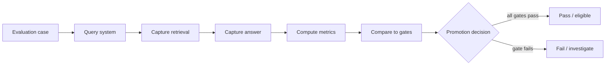

# Evaluation

This repository evaluates changes to the legal RAG pipeline as a regression
and promotion workflow. It exercises the query and summary APIs against
versioned golden cases, records case-level evidence, computes aggregate
metrics, and compares a challenger run with a checked-in baseline.

The evaluation thresholds are project-specific engineering gates. They are not
universal legal-AI quality standards and do not replace expert legal review.

## Evaluation flow



## 1. Golden dataset structure

The golden datasets are JSON files with a top-level `cases` array:

- [`mvp/golden_set_smoke.json`](../mvp/golden_set_smoke.json) is the smaller
  smoke suite used for pull-request checks.
- [`mvp/golden_set_template.json`](../mvp/golden_set_template.json) is the
  broader answer and summary suite used for full evaluation.

Each case includes:

- `id`: stable case identifier.
- `kind`: `answer` or `summary`.
- `category`: such as direct lookup, multi-chunk synthesis, citation
  sensitivity, mixed domain, or abstention.
- `question` and `top_k` for answer cases.
- `source_file` and `max_chunks` for summary cases.
- `should_abstain` and `expected_mode`.
- `min_citations` and `require_valid_citations`.
- `expected_contains_any` and `expected_not_contains_any` content checks.
- optional `human_scores` for faithfulness and answer correctness.
- `notes` describing the intent of the case.

The runner validates the case schema before executing it. Cases should be
versioned with the corpus and prompt/retrieval configuration they represent.

## 2. Retrieval evaluation

Answer cases call `POST /query/answer`; summary cases call
`POST /query/summary`. The runner records the response, mode, used chunks,
citations, checks, errors, and latency for every case.

The current aggregate field is `retrieval_recall_at_5`. In the implemented
runner it is currently a proxy based on the proportion of successful cases
that contain citations, rather than a labeled relevant-document recall
measurement. The golden files do not currently provide per-case relevant
chunk IDs or relevance judgments. This distinction is recorded in each
report's proxy notes.

The retrieval path itself uses the application's configured vector retrieval
and reranking behavior. Evaluation therefore detects regressions in the
observable answer/citation contract, but does not yet provide a standalone
retrieval benchmark with independently labeled passages.

## 3. Generation evaluation

Generation checks include:

- expected response mode;
- expected and forbidden content fragments;
- answer/summary structure checks;
- abstention behavior;
- citation requirements.

`faithfulness` and `answer_correctness` use the per-case `human_scores` labels
when those labels are present. For cases without labels, the runner uses
proxy values derived from successful cases. The reports explicitly identify
the number of human-labeled cases and the proxy components.

This makes the current suite useful for regression detection, but it is not a
replacement for a larger domain-expert evaluation set.

## 4. Citation evaluation

Citation evaluation operates at both the response and inline-marker levels.
The runner checks:

- citation count against `min_citations`;
- citation structure and required source/chunk fields;
- duplicate and sequential citation IDs;
- inline markers such as `[C1]` resolving to returned citations;
- missing inline citations when citations are required;
- invalid citation counts.

The application maps citation IDs back to retrieved source records, including
document/source, chunk, and available page or section metadata. Unknown or
malformed generated markers are removed or repaired by the existing citation
integrity logic before the response is returned.

The aggregate `invalid_citation_rate` is calculated from invalid citation
counts divided by total citations in successful cases. A zero value means no
invalid citations were counted by that run; it does not prove that every legal
proposition is substantively correct.

## 5. Abstention evaluation

Cases can set `should_abstain` to `true` or `false`. The runner compares the
observed abstention state with that expected label and reports
`abstention_accuracy` over labeled cases.

Out-of-domain and noisy questions in the golden sets test whether the system
returns its explicit insufficient-evidence response rather than fabricating a
supported-looking answer. Cases without an abstention label do not contribute
meaningful supervision; when no labels exist, the runner documents its
default rather than treating that result as a measured capability.

## 6. Latency evaluation

The runner measures elapsed time around each HTTP request, including retries
when retries are enabled. It stores case-level `latency_ms` and reports mean,
median, and inclusive p95 latency for the run. Latency is also broken down by
answer and summary case kind.

The scoring rubric applies this penalty:

- p95 <= 3,000 ms: no penalty;
- 3,001-5,000 ms: `0.02` penalty;
- above 5,000 ms: `0.05` penalty and the latency gate fails.

Timeouts, retry settings, and backoff controls are retained in each report so
latency results can be interpreted with their runtime conditions.

## 7. Baseline vs challenger comparison

The checked-in baseline is
[`mvp/experiments/baseline_metrics.json`](../mvp/experiments/baseline_metrics.json).
The scoring formula is:

```text
0.40 * faithfulness
+ 0.30 * answer_correctness
+ 0.20 * retrieval_recall_at_5
+ 0.10 * abstention_accuracy
- 0.10 * hallucination_rate
- 0.05 * invalid_citation_rate
- latency_penalty
```

The required gates are:

| Metric | Gate |
|---|---:|
| Faithfulness | >= 0.75 |
| Answer correctness | >= 0.70 |
| Retrieval recall proxy at 5 | >= 0.65 |
| Hallucination rate | <= 0.12 |
| Invalid citation rate | <= 0.10 |
| Latency p95 | <= 5,000 ms |

The challenger wins when its overall score improves by at least `0.02` and
does not regress a gate that passed for the baseline. If scores differ by less
than `0.02`, the comparison uses lower latency and lower hallucination rate as
tie-breakers. Otherwise the baseline wins or the result is a tie.

## 8. CI promotion logic

The implementation is in
[`backend/scripts/eval_runner.py`](../backend/scripts/eval_runner.py),
[`backend/scripts/eval_series.py`](../backend/scripts/eval_series.py), and
[`backend/app/evaluation/scoring.py`](../backend/app/evaluation/scoring.py).

[`eval-gates.yml`](../.github/workflows/eval-gates.yml) runs:

- **PR smoke evaluation** with the smoke golden set, three repeated offline
  runs by default, `--require-passing-rate 1.00`, and a zero required winner
  rate for the deterministic offline check.
- **Scheduled/workflow-dispatched full evaluation** with the broader golden
  set, two repeated offline runs by default, and a required passing rate of
  `1.00`.

The workflow uploads JSON and Markdown run artifacts. Offline mode validates
case behavior and variance without treating a deterministic simulation as a
live challenger promotion decision. Live runner executions enforce that the
challenger wins the baseline comparison; a non-challenger result exits
non-zero. The workflow does not deploy a model or change the baseline
automatically.

## 9. Human-review workflow

The golden cases contain initial `human_scores` labels, and
[`mvp/human_scores_reviewer_worksheet.csv`](../mvp/human_scores_reviewer_worksheet.csv)
provides a worksheet for reviewer scores and notes. A practical review cycle
is:

1. Run the smoke or full evaluation and retain the JSON/Markdown artifacts.
2. Review failed cases and cases with low confidence, abstention mismatches,
   citation issues, or content expectation failures.
3. Score faithfulness and answer correctness against only the retrieved
   evidence; record notes and reviewer values in the worksheet.
4. Update the versioned golden set or prompts only when the expected behavior
   is intentionally changed.
5. Re-run the suite and inspect the baseline/challenger comparison before
   promotion.

The current worksheet is a review aid, not an automated adjudication system.
It does not provide a large independent panel of legal-domain reviewers.

## 10. Checked-in evaluation summary

The checked-in baseline artifact reports:

| Metric | Recorded value |
|---|---:|
| Faithfulness | 0.9163 |
| Answer correctness | 0.8962 |
| Retrieval recall proxy at 5 | 1.0000 |
| Abstention accuracy | 0.7500 |
| Hallucination rate | 0.0000 |
| Invalid citation rate | 0.0000 |
| Latency p95 | 2,224 ms |

These are recorded values from the repository artifact, not a newly executed
benchmark in this documentation task.

The latest dated release-readiness artifact currently checked in,
[`release_candidate_metrics_20260418_000425.json`](../mvp/experiments/release_readiness/release_candidate_metrics_20260418_000425.json),
reports faithfulness `0.9191`, answer correctness `0.8945`, retrieval recall
proxy `1.0000`, abstention accuracy `0.7273`, hallucination rate `0.0000`,
invalid citation rate `0.0000`, and latency p95 `46,976 ms`. That latency value
exceeds the repository's 5,000 ms latency gate. It should therefore be read as
a historical release-readiness result requiring investigation, not as a
production performance claim.

## Limitations

- The corpus and golden sets are small and controlled.
- Retrieval recall is currently a citation-presence proxy, not labeled
  relevant-chunk recall.
- Faithfulness and correctness are only partly human-labeled; remaining values
  use documented proxies.
- Citation validity is structural and marker-based; it does not independently
  validate legal authority or substantive legal interpretation.
- Offline evaluation is deterministic simulation and is not live model latency.
- Local inference, retries, database state, and hardware can materially affect
  latency.
- There is no large, independently adjudicated legal-domain benchmark.
- Evaluation does not establish legal advice quality, enterprise readiness,
  tenant isolation, access-control correctness, or production observability.
