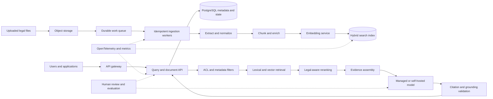

# Production Architecture Evolution

> **Design document only:** this describes how the local legal RAG prototype
> could evolve into a production legal-AI platform. None of the AWS services,
> distributed workers, enterprise security controls, or production deployment
> patterns described here are deployed in this repository.

The current project is a local, production-oriented prototype with FastAPI,
PostgreSQL/pgvector, document parsing, chunking, embeddings, hybrid
reranking, grounded answers, citation validation, abstention, and evaluation
gates. The design below preserves those boundaries while identifying the
capabilities required for a production service.

## Evolution overview



## Ingestion

### Object storage

Production uploads should land in durable object storage such as S3 rather
than being tied to a worker's local filesystem. The object key should include
an immutable document identity and version, for example:

```text
tenants/{tenant_id}/matters/{matter_id}/documents/{document_id}/versions/{version}/source.pdf
```

Object metadata should record content type, size, checksum, uploader,
tenant/matter ownership, retention policy, and the ingestion schema version.
The original object should be retained separately from derived text,
chunks, embeddings, and search records so that derived data can be rebuilt.

### Asynchronous queue and workers

An upload event should enqueue a document-version ingestion job. SQS is a
natural AWS option for a managed queue; Kafka is another possible choice when
durable event streams and multiple consumers are justified. The queue should
carry a job ID, document identity, version, object key, checksum, and
processing schema versions rather than the document contents.

Workers can then execute bounded stages:

1. Fetch and checksum the object.
2. Parse PDF, DOCX, or text content.
3. Normalize text and preserve page/section provenance.
4. Chunk the normalized content.
5. Generate embeddings.
6. Write searchable chunks and document state.
7. Publish an indexed/ready event.

Stages can initially be one worker workflow. They can later be split when
throughput, isolation, or independent scaling requires it. Each stage should
write durable state and a structured error rather than relying on process
logs alone.

### Durable document states

A document version should have an explicit state machine, for example:

```text
RECEIVED
  -> PROCESSING
  -> PARSED
  -> CHUNKED
  -> EMBEDDING
  -> INDEXED
  -> READY
```

Failure states should retain the failing stage, error class, attempt count,
timestamps, and the last successful derived artifact:

```text
RETRYABLE_FAILURE
PERMANENT_FAILURE
QUARANTINED
```

The API should expose state to clients and should not present a version as
searchable until its required chunks, embeddings, ACL metadata, and
provenance records are committed.

### Retries and dead-letter queues

Workers should retry transient failures such as object-store timeouts,
temporary database unavailability, rate limits, and model-service failures.
Retries need exponential backoff, a maximum attempt count, and visibility
timeouts longer than the expected processing interval.

Malformed files, unsupported formats, invalid schemas, and repeatedly failing
jobs should move to a dead-letter queue (DLQ) or quarantine store. DLQ
records should include the document version, stage, error, and correlation ID
so operators can repair or replay them safely. A replay must use the same
idempotent write rules as the original job.

## Idempotency

Queue delivery is normally at-least-once. A worker must therefore be safe to
run more than once for the same message. Retries from SQS or Kafka must not
create duplicate documents, chunks, or vectors.

Recommended identities are:

```text
document:  document_id + document_version
chunk:     document_id + version + chunk_index
embedding: chunk_id + embedding_model_version
```

These identities should be represented by database uniqueness constraints or
equivalent conditional writes. A worker should:

- use deterministic version and chunk keys;
- upsert or compare-and-set durable state;
- record the input checksum and parser/chunker versions;
- avoid generating a new random primary key for a retry of the same logical
  record;
- make embedding writes conditional on the `(chunk_id, model_version)` key;
- commit related state and derived records transactionally where possible;
- distinguish a legitimate new document version from a replay of an existing
  version.

For example, if a queue message is delivered twice after a worker has already
committed an embedding, the second worker should observe the existing
`chunk_id + embedding_model_version` record and reuse it. It should not append
another vector to the search index. Without this guarantee, at-least-once
delivery causes duplicate evidence, distorted retrieval rankings, wasted
embedding cost, and ambiguous citation provenance.

Idempotency keys should also be carried through API requests and downstream
events. A replay or operator-triggered re-index should be explicit about
whether it is rebuilding the same version or creating a new derived index
version.

## Retrieval

The prototype already combines vector similarity with lexical overlap and
supports metadata filtering. A production retrieval service could extend
that boundary as follows:

### Hybrid lexical/vector search

Use a search layer that can combine:

- dense vector similarity for conceptual similarity;
- lexical/BM25 matching for exact statutory terms, citations, names, and
  document identifiers;
- filters for tenant, matter, document ACL, jurisdiction, court, date,
  practice area, document type, and document status.

The filter must be applied before evidence is returned, not only after the
top results have been selected. ACL filtering should be enforced server-side
and independently of UI-provided filters.

### Reranking

A reranker can score a bounded candidate set using query/evidence relevance,
without allowing it to bypass access controls or provenance requirements.
The service should retain vector, lexical, reranker, and final scores for
diagnostics and evaluation.

### Legal authority signals

Where validated metadata is available, ranking can incorporate signals such
as jurisdiction, court level, decision date, canonical citation, treatment
or authority type, and practice area. These signals must come from governed
metadata or reviewed enrichment pipelines. They should not be inferred by an
LLM and persisted as authoritative legal facts without validation.

Every evidence item should retain its document version, chunk identity,
source location, and metadata so that the answer and citation validator can
resolve it back to the exact retrieved record.

## Security

Production legal data requires controls that are deliberately outside the
local prototype.

### Authentication and authorization

- Authenticate users and service principals through an enterprise identity
  provider.
- Authorize API operations using roles and scopes, not only authentication
  status.
- Enforce document ACLs in ingestion, retrieval, summarization, exports, and
  administrative workflows.
- Keep tenant and matter identifiers in every relevant state and search
  record.
- Apply least privilege to API services, workers, databases, queues, object
  storage, and model endpoints.

### Isolation and data protection

Matter and tenant isolation should be defense in depth: tenant-aware database
constraints or row-level security, mandatory request context, ACL-aware
retrieval, separate object prefixes, and tests that attempt cross-tenant
access. Authorization failures should be explicit and auditable.

Use encrypted transport and encryption at rest for object storage, databases,
queues, backups, and search indexes. Manage keys through a controlled KMS
process where appropriate. Secrets should come from a managed secrets
facility, never source control, container images, or ordinary logs.

### Prompt injection and untrusted content

Retrieved documents are untrusted input, even when they are legal documents.
Production controls should:

- separate system instructions from retrieved content;
- delimit and label evidence as data;
- ignore instructions embedded in documents;
- constrain tools and outbound actions;
- validate citations against retrieved records after generation;
- detect attempts to exfiltrate hidden prompts, credentials, or other
  documents;
- log and review prompt-injection events.

Prompt defenses do not replace ACL enforcement. A model must never receive
evidence that the requesting principal is not allowed to access.

## Evaluation

The local evaluation framework provides a foundation for production
regression testing. A production program should combine:

### Offline golden set

Run versioned golden cases in CI for retrieval, answer grounding, citation
resolution, abstention, summary structure, and latency budgets. Store the
corpus version, prompt version, embedding model version, reranker version,
configuration, and evaluation artifact with every run.

### Production sampling

With appropriate privacy, legal, and contractual controls, sample
de-identified production requests and responses. Capture retrieval IDs,
filters, scores, model version, citations, abstention state, latency, and
failure taxonomy. Do not use raw client matter content in general logs.

### Human review

Route uncertain, low-confidence, abstained, citation-failed, and
high-impact responses to qualified reviewers. Record evidence-grounded
faithfulness, answer correctness, citation correctness, and abstention
appropriateness separately.

### Regression feedback

Production failures should become candidate regression cases after review:

```text
production failure
  -> privacy and legal review
  -> de-identification or synthetic equivalent
  -> failure taxonomy
  -> golden case / adversarial case
  -> CI evaluation
```

This prevents a one-time fix from remaining dependent on an unrecorded
incident.

## Observability

### OpenTelemetry and infrastructure monitoring

Instrument API requests, queue messages, worker stages, database queries,
object-store operations, embedding calls, reranking, and model calls with
OpenTelemetry traces and metrics. Propagate a correlation ID from upload or
query through every downstream stage.

Infrastructure dashboards should cover:

- CPU, memory, disk, network, and container restarts;
- queue depth, message age, visibility timeouts, retries, and DLQ volume;
- database connections, locks, storage, slow queries, and replication;
- object-store failures and worker throughput;
- model endpoint availability, throttling, and error rates.

### RAG and LLM traces

Structured traces should make it possible to answer:

- Which document versions and chunks were retrieved?
- Which metadata and ACL filters were applied?
- What were vector, lexical, reranker, and final scores?
- Which prompt/model version was used?
- Which citation IDs were generated and validated?
- Why did the system answer, abstain, reject, or repair the response?

Sensitive document text should be redacted, sampled, or stored under strict
access controls. Traces must not become an uncontrolled copy of client
matters.

### Cost and quality signals

Track token and embedding usage, model cost, storage cost, queue cost, and
cost per completed query or document version. Track p50/p95/p99 latency
separately for retrieval, generation, and end-to-end requests.

Quality dashboards should include retrieval success, abstention accuracy,
human review scores, invalid/unresolved citation counts, prompt-injection
events, failed cases, and top failure taxonomy categories. Alerts should
cover both availability and quality regressions.

## Deployment options

The prototype can be packaged as a Docker image, with configuration and
secrets injected at runtime. Possible AWS deployment choices include:

### ECS

Amazon ECS could run the API service and worker services with managed
orchestrated tasks. It is a reasonable option when the platform needs
container scheduling without adopting Kubernetes operations.

### EKS

Amazon EKS could run the same services when the organization already
standardizes on Kubernetes, needs Kubernetes-native workload controls, or
expects a broader platform of independently managed services. EKS adds
operational complexity and should not be selected merely for architectural
appearance.

### Supporting services

- **RDS PostgreSQL**: relational metadata, durable state, and pgvector where
  its scale and operational characteristics remain appropriate.
- **S3**: immutable source documents, derived artifacts, evaluation reports,
  and controlled retention.
- **SQS**: asynchronous ingestion jobs, retries, and DLQ handling.
- **Managed model service**: a possible replacement for local Ollama when
  managed capacity, enterprise controls, or model operations are required.
  The replacement must preserve grounding, timeout, privacy, cost, and
  citation-validation controls.

A dedicated lexical/vector search service may become appropriate as corpus
size, filtering complexity, or query volume grows. That is a capacity and
operational decision, not a requirement for the current local prototype.

## Explicit non-claims

This document does not claim that the repository currently has:

- AWS deployment or AWS credentials/configuration;
- ECS, EKS, RDS, S3, or SQS infrastructure;
- distributed ingestion workers or a DLQ;
- tenant, matter, or document-ACL enforcement;
- enterprise authentication, authorization, KMS, or secrets management;
- OpenTelemetry production instrumentation;
- a managed model service;
- production SLOs, legal-domain certification, or enterprise readiness.
